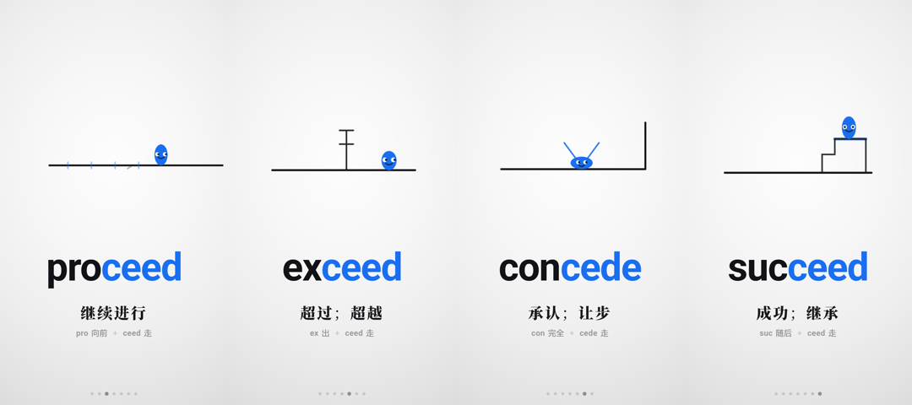

# root-word-animation · 英语词根记忆短视频生成器

把一个英语词根做成 **30–50 秒竖版记忆短片**（1080×1920 / 30fps）。每场演一个单词：画面用极简几何演绎词义，演完冻结、念一遍整词，再进下一场。

> An automated pipeline that turns an English root word into a 9:16 short video for vocabulary learning — design table → geometry animation → TTS → frame-accurate render → verified MP4.

**唯一总纲：词义决定画面，元素不许反过来限制表现。**



*ced 词族四场的冻结帧：轴线 + 档杆 → 超过横梁；退到墙边举手认输 → 承认；登上两级台阶 → 成功。*

---

## 它长什么样

| 项 | 规格 |
|---|---|
| 画幅 / 帧率 | 1080×1920（9:16，抖音）、30fps |
| 单场时长 | 5.2s 动画 + `voDur` 冻结段（播整词配音） |
| 词数 | 3–7 个/片，总长 30–50s |
| 画面基调 | 白底、品牌蓝 `#1a6ff0`、墨黑 `#121316`、Roboto Bold |
| 文字区 | 单词（词根染蓝）/ 中文释义 / 词素分解 |

画面元素只有三件起手：**一条线、一颗球、一层道具**。但三者都能变：球可以长成卡车、猫、箱子；线可以变成门框、栅栏、台阶、屋顶；必要时线退场、球滚出、卡车驶入，或者为这个单词现场造一个新元素（印章、界栏、证件）。

```
spect      横线，球在线上左右扫视        → 看
inspect    杯形，球钻进杯子只露眼睛      → 往里看 = 检查
respect    Λ 形，球退回叉口仰头看        → 回头再看 = 尊敬
```

---

## 环境要求

| 依赖 | 版本 / 说明 | 检查 |
|---|---|---|
| Node.js | ≥ 18 | `node -v` |
| Python | ≥ 3.9，需 `pip install edge-tts` | `python -c "import edge_tts"` |
| ffmpeg | 需在 `PATH` 里（含 `ffprobe`） | `ffmpeg -version` |
| Playwright | `npm i playwright`，用于逐帧截图 | `node -e "require('playwright')"` |
| Chrome | 可选。有则用系统 Chrome，无则用 Playwright 自带 chromium | — |

Chrome 与 Playwright 的查找顺序：`$CHROME_PATH` → 各系统默认安装位 → `$PLAYWRIGHT_PATH` → 本机 `playwright` 依赖。找不到会给出明确报错，不会静默降级。

---

## 安装

**A. 作为 WorkBuddy / Claude 技能**

```bash
git clone https://github.com/dongtaowei54-sys/root-word-animation.git \
  ~/.workbuddy/skills/root-word-animation
```

之后在对话里发一个词根（`spect`）或说「做一个 XX 的词根动画」即可触发。

**B. 当命令行工具用**

```bash
git clone https://github.com/dongtaowei54-sys/root-word-animation.git
cd root-word-animation && npm install      # 只装 playwright
export SK=$PWD                             # Windows: set SK=%cd%
```

---

## 快速开始

```bash
mkdir my-root && cd my-root
cp -r $SK/examples/ced/* .                 # 拿 ced 当模板：design.json + scenes.js

python $SK/scripts/tts.py       --dir .    # 1. 配音 + 回填 speech / voDur
node   $SK/scripts/build-root.js --dir .   # 2. 注入母版 → index-ced.html + timeline.json
node   $SK/scripts/snap.js       --dir .   # 3. 预检截图 _snap/（逐张看！）
node   $SK/scripts/make-audio.js --dir .   # 4. 成品音轨
node   $SK/scripts/render.js     --dir .   # 5. 逐帧渲染（4–5 分钟）
node   $SK/scripts/mix.js        --dir .   # 6. 两版 mp4
node   $SK/scripts/verify.js --dir . --mp4 ced-1080x1920.mp4   # 7. 五道校验
```

不配音也能先看节奏：第 2 步跑完直接打开 `index-ced.html` 就是可直接播放的网页版动画。

---

## 九道工序

| 步 | 动作 | 产出 |
|---|---|---|
| 1 | 接词根，不追问 | — |
| 2 | 查 `dict/词根词典.csv`，按可演性筛词（3 分留、2 分留、1 分丢） | 词表 |
| 3 | 逐词答四问 → 出**构思表** | **必须给人看，渲染一次 4–5 分钟** |
| 4 | 写 `design.json` + `scenes.js` | 两个文件 |
| 5 | `tts.py` | 配音 + 回填时长 |
| 6 | `build-root.js` | `index-<root>.html` + `timeline.json` |
| 7 | `snap.js` | `_snap/*.png`，逐张目检 |
| 8 | 音轨 → 渲染 → 混流 | 两个 mp4 |
| 9 | `verify.js` | 校验报告 |

**第 3 步不能跳过。** 构思表要能在 30 秒内扫完：线型、球体形态、道具、镜头、音效点，外加每个元素的进出场理由。

---

## 目录结构

```
root-word-animation/
├── SKILL.md                    技能入口：流程与底线
├── assets/
│   ├── base.html               母版（时间轴 / 渲染循环 / 球与线的引擎）
│   └── template-scenes.js      7 场起步模板
├── references/
│   ├── design-principles.md    设计总纲：四问、角色最小化、元素调色盘、进出场
│   ├── design-patterns.md      16 个可抄套路（球变车、门框线型、钩爪、粒子…）
│   ├── design-format.md        字段格式、球形态、表情、道具原语、布局基准
│   ├── design-table.md         构思表模板与硬约束
│   ├── dictionary.md           词典字段与可演性判据
│   ├── pipeline.md             九步完整命令与目录约定
│   └── pitfalls.md             踩坑清单（每条都真踩过）
├── scripts/
│   ├── tts.py                  edge-tts 配音 + 静音裁剪 + 时长回填
│   ├── build-root.js           母版注入（LINES / SCENES / CUES / VO_DUR / 字号）
│   ├── snap.js                 Playwright 关键帧截图
│   ├── make-audio.js           音轨合成（BGM + 音效 + 配音）
│   ├── render.js               逐帧渲染
│   ├── mix.js                  ffmpeg 混流出两版 mp4
│   └── verify.js               五道校验
├── dict/词根词典.csv            选词用的起点词典（可自行扩充/替换）
└── examples/ced/               ced 词族的完整示例
```

---

## 设计原则（摘要）

1. **四问**：主角是谁？谁该变身/变形/退场？什么动作？冻结帧能不能当单词卡？
2. **角色最小化**：主球能独自演完的，就不要加副球。副球只在「动作必须两个角色」时进场。
3. **元素按需增删**：线多余就让它让位，结构不够就长出细节；球和线都撑不起词义时，为这个词现场造一个新元素。
4. **进出场必须有理由**：换角色一律用位移（滚出/驶入/掉落/被吊走），不靠 `opacity` 淡入淡出；只有「整场都不再需要它」才允许淡出。
5. **音效时刻从动画分支点抄**，不凭听感调；`pop`（1.60s）前后 ±0.15s 内不放任何音效。

详细判据见 `references/design-principles.md`，反例清单在同一文件末尾。

---

## 五道校验

| 项 | 标准 |
|---|---|
| 配音起音 | 最大偏差 ≤ 50 ms |
| 音效起音 | ≤ 33 ms（瞬态）/ ≤ 66 ms（渐入） |
| 响度与时长 | 时长 ≈ timeline，mean −19 ± 2.5 dB，max ≤ −0.5 dB |
| 冻结静止 | 段内两帧 PSNR > 45 dB |
| 成片偏移 | 0 ms |

冻结静止靠 `_snap/<word>-frozen.png` 目检，脚本给不出「画面好看」的结论——第 7 步必须真的看图。

---

## 常见问题

| 现象 | 原因与处理 |
|---|---|
| `缺少 playwright` | `npm i playwright`；或设 `PLAYWRIGHT_PATH` 指向已装目录 |
| 截图/渲染起不来浏览器 | 装 Chrome，或 `npx playwright install chromium`；也可用 `CHROME_PATH` 指定 |
| `ffmpeg: command not found` | 装 ffmpeg 并确认 `ffmpeg -version` 能跑 |
| 渲染报「帧目录已有 N 个文件」 | 这是防误删守卫：`rm -rf _frames` 后重跑 |
| 校验报音效起音 74ms 左右超限 | 多半是前一个音效的尾音污染了后一个的基线，检查 `pop` 附近 ±0.15s 是否还有音效 |
| 换场时画面跳一下 | 检查上一场 `linePts / lineDelta` 是否在 2.6s 前就演进完（母版 4.32s 起自动收回形变） |

---

## License

MIT，见 [LICENSE](LICENSE)。
